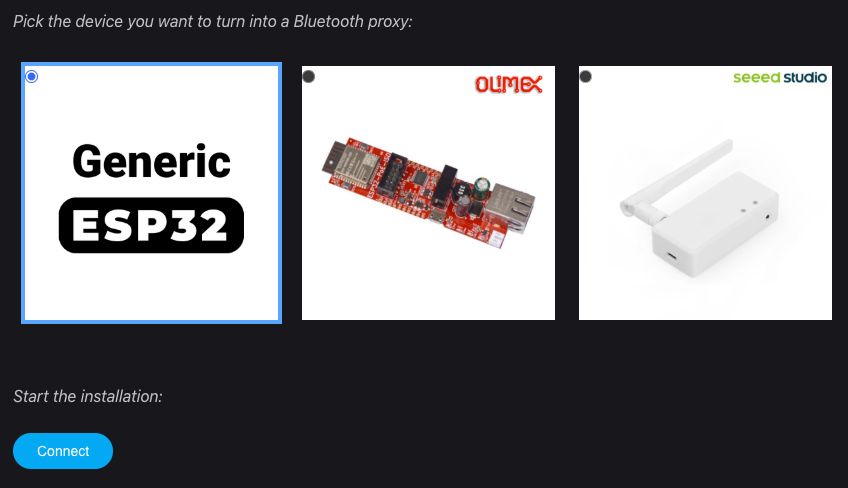
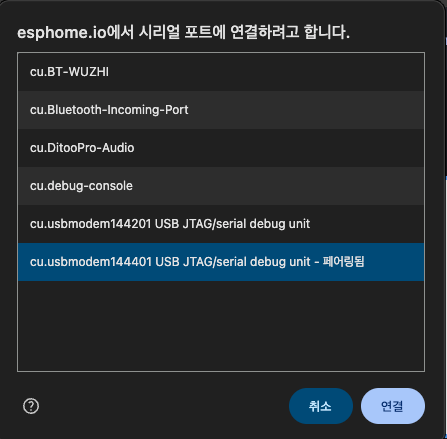
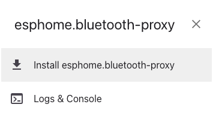
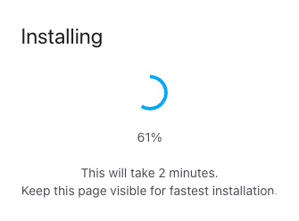
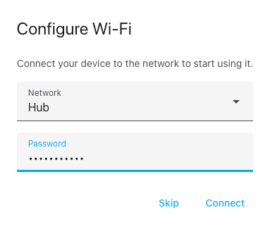
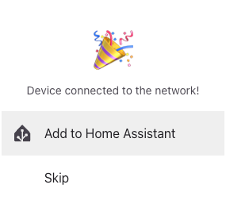
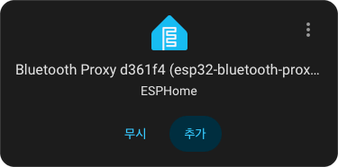

# Home Assistant 블루투스 프록시 소개와 설치 안내

[English](bluetooth.md) | **한국어**

Bluetooth proxy는 BLE 기기 가까이에 두는 수신기로, 홈 네트워크를 통해 Home Assistant에 연결합니다. 이미 잘 동작하는 로컬 Bluetooth 어댑터를 계속 사용해도 됩니다. HA 서버와 기기 사이가 멀 때 프록시가 유용합니다. 커스텀 통합 설치만으로 프록시가 설정되지는 않습니다.

이 사용자 안내는 blesession을 사용하지 않는 통합에도 적용할 수 있습니다. 안내를 읽거나 프록시를 설정하기 위해 Python 라이브러리를 설치할 필요는 없습니다. 기기 자체의 설정·인증·지원 여부는 해당 통합 안내를 따르세요.

## 블루투스 프록시란?

BLE(Bluetooth Low Energy)는 온습도 센서, 체중계, 도어락 등에서 사용하는 저전력 무선 통신입니다. 배터리로 동작하는 작은 기기에 적합하지만, 벽과 장애물 때문에 HA 서버의 Bluetooth 어댑터까지 신호가 닿지 않을 수 있습니다.

프록시는 BLE 기기 가까이에서 신호를 받고, 집의 Wi-Fi나 유선 LAN으로 HA에 전달합니다. 연결을 지원하는 기기에는 HA의 읽기·쓰기 요청도 전달합니다.

```text
BLE 기기 ← Bluetooth → 프록시 ← Wi-Fi / 유선 LAN → Home Assistant
```

예를 들어 서버에서 먼 현관 센서가 잘 잡히지 않으면 현관 근처에 프록시를 놓습니다. HA에서 지원하는 기기라면 스마트폰을 곁에 두지 않고도 상태를 확인하고 자동화에 사용할 수 있습니다. 프록시가 모든 Bluetooth 제품을 자동으로 지원하게 만드는 것은 아닙니다. 이 안내의 대상은 BLE이며 Bluetooth Classic 오디오 중계용이 아닙니다. 지원 범위는 [HA Bluetooth 안내](https://www.home-assistant.io/integrations/bluetooth/)와 해당 기기 통합에서 확인하세요.

수신이 부족한 방에 프록시를 추가할 수도 있습니다. 각 프록시는 기존 홈 네트워크에 연결하며 프록시끼리 Bluetooth 메시를 구성하지 않습니다. 같은 센서의 광고를 여러 프록시가 수신할 수 있고 HA가 정보를 모아 처리합니다. 광고 수신과 실제 연결은 다르므로, 프록시를 추가한 뒤에는 기기 통합에서 실제 동작도 확인하세요.

처음 설치한다면 **기기 선택 → 펌웨어 설치 → HA 등록 → 기기 연결 확인** 순서로 진행합니다. 설치 후 관리는 아래 [업데이트](#updates)와 [설정 변경](#configuration-changes)을 참고하세요.

## 1. 기기 선택

기본 추천은 유선 Ethernet·PoE·외장 안테나 구성을 위한 **Seeed Studio XIAO W5500 Ethernet Adapter V1.2**입니다. **USB-A 동글 형태**를 원하면 **M5Stack AtomS3U**를 추천합니다. AtomS3U는 USB-A 커넥터가 달린 기기이며 Wi-Fi로 네트워크에 연결됩니다.

| 기기 | 구매 전 확인 | 구매 페이지 |
|---|---|---|
| **XIAO W5500 Ethernet Adapter V1.2** | V1.2 여부, 포함된 XIAO 모듈·안테나, 선택한 구성의 PoE 전원 옵션 | [AliExpress](https://ko.aliexpress.com/item/1005009310322353.html) |
| **M5Stack AtomS3U** | USB-A 동글, USB 전원과 Wi-Fi 필요. Generic ESP32 웹 설치 또는 직접 빌드 | [AliExpress](https://ko.aliexpress.com/item/1005005643544014.html) |

XIAO W5500의 경우 [ESPHome 공식 설치기](https://esphome.io/projects/?type=bluetooth)는 **V1.2만** 지원합니다. 구형 리비전에는 배선·RF 제약이 있습니다. [Seeed 보드 안내](https://wiki.seeedstudio.com/esphome_xiao_w5500_ethernet_adapter/)와 [AtomS3U 사양](https://docs.m5stack.com/en/core/AtomS3U)을 실제 구매 옵션과 비교하세요. 판매 링크만으로 리비전·포함 액세서리가 보장되지는 않습니다. 모든 통합·기기 조합을 실물 검증했다는 의미도 아닙니다.

## 2. 프록시 펌웨어 설치

펌웨어를 설치하면 프록시의 기존 펌웨어가 교체됩니다. 기존 설정이 있으면 먼저 보관하고, 정확한 보드에 해당하는 절차를 따르세요.

### 설치 전 준비

- 프록시 보드와 안정적인 전원, PC, Chrome 또는 Edge를 준비합니다. 케이블 연결형 보드는 충전 전용이 아닌 USB 데이터 케이블이 필요합니다. AtomS3U는 USB-A 포트에 직접 연결합니다.
- Wi-Fi 모델은 2.4 GHz 네트워크 이름과 비밀번호, 유선 모델은 LAN 연결을 준비합니다. USB는 설치·전원용이며, 프록시는 동작 중 Wi-Fi/LAN으로 HA와 통신합니다.
- 보드 이름·칩·리비전을 확인합니다. XIAO W5500 V1.2는 전용 항목을 선택합니다. AtomS3U는 **Generic ESP32** 항목을 선택합니다. 설치는 [ESPHome 웹 설치기](https://esphome.io/projects/?type=bluetooth)에서 진행합니다.

### XIAO W5500 V1.2: 공식 설치기

1. USB 데이터 케이블로 컴퓨터와 보드를 연결합니다.
2. Chrome 또는 Edge에서 [ESPHome Bluetooth 설치기](https://esphome.io/projects/?type=bluetooth)를 엽니다. **Seeed Studio XIAO W5500 Ethernet Adapter V1.2**를 선택하고 시리얼 포트를 연결한 뒤 설치 안내를 따릅니다.
3. Ethernet을 홈 네트워크에 연결하고 해당 보드·구성이 지원하는 방법으로 전원을 공급합니다. 설치된 Ethernet 펌웨어는 Wi-Fi를 비활성화하므로 유선 네트워크가 필요합니다.
4. 아래 HA 등록 단계로 진행합니다. 다운로드 모드 등 보드별 절차는 [Seeed 안내](https://wiki.seeedstudio.com/esphome_xiao_w5500_ethernet_adapter/)를 확인하세요.

설치 중에는 케이블이나 전원을 분리하지 마세요. 이 모델은 설치기의 Wi-Fi 입력 과정이 필요하지 않습니다. 마지막에 HA 추가 버튼이 표시되면 바로 등록해도 되고, 건너뛴 뒤 아래 절차로 등록해도 됩니다.

### AtomS3U·일반 ESP32: 웹 설치기

AtomS3U는 **Generic ESP32** 항목을 선택하고 **CONNECT → 시리얼 포트 선택 → INSTALL** 순서로 진행합니다. Windows에서는 포트가 `COM3` 같은 이름으로 표시될 수 있습니다. 설치 완료 후 안내에 따라 2.4 GHz Wi-Fi 정보를 입력하고 HA에 등록합니다. 일반 ESP32 보드도 이 흐름을 따릅니다. 전용 항목이 있는 보드는 해당 항목을 사용하세요.

### 웹 설치 화면 따라가기

아래는 제공된 설치 글의 화면 예시입니다. PDF에서 원본 이미지를 추출하고 대화상자 주변 배경을 정리했습니다. 현재 화면의 기기 목록·버튼 이름은 다를 수 있습니다.

**① 정확한 보드를 고르고 CONNECT를 누릅니다.** 아래 이미지처럼 Generic ESP32를 선택합니다. XIAO W5500 V1.2는 오른쪽의 전용 항목을 선택합니다.

<p align="center">
  
</p>

**② PC에 연결한 보드의 시리얼 포트를 선택합니다.** 아래는 macOS 화면이며 Windows에서는 `COM` 포트로 표시될 수 있습니다. 다른 Bluetooth 포트가 아니라 연결한 USB 보드의 포트를 선택하세요.

<p align="center">
  
</p>

**③ Install을 누르고 완료될 때까지 기다립니다.** 펌웨어가 교체되므로 기존 설정을 먼저 보관합니다. 진행 중에는 전원을 끄거나 USB를 뽑지 마세요.

| 설치 시작 | 설치 진행 중 |
|:---:|:---:|
|  |  |

**④ Wi-Fi 모델은 설치 완료 후 네트워크를 설정합니다.** 본인의 2.4 GHz SSID와 비밀번호를 입력합니다. 이미지의 네트워크 이름은 예시입니다. XIAO W5500의 Ethernet 펌웨어는 이 단계 대신 LAN 연결을 확인합니다.

<p align="center">
  
</p>

네트워크 연결 후에는 아래 **Home Assistant에 프록시 등록** 단계로 진행합니다.

<details>
<summary>선택 사항: AtomS3U 설정을 직접 빌드·관리하기</summary>

웹 설치 대신 YAML을 직접 관리하려면 아래 방법을 사용합니다. AtomS3U의 ESP32-S3·8 MB flash에 맞춘 설정 예제입니다.

1. [ESPHome Device Builder](https://esphome.io/install/getting-started/)를 설치·열고 `atoms3u-proxy`라는 ESP32-S3 기기를 만듭니다. 생성 과정에서 입력한 Wi-Fi 정보와 생성된 API 암호화 키를 보관합니다.
2. 설정을 편집합니다. 아래 최소 예제는 AtomS3U의 ESP32-S3·8 MB flash를 사용하며 마이크·LED·적외선 기능은 켜지 않습니다. Device Builder의 `secrets.yaml`에 아래 이름으로 Wi-Fi 정보와 생성된 API 키를 저장합니다. 키 자리에 예시 문구가 아닌 실제 생성된 키를 넣으세요. 새 키가 필요하면 터미널에서 `openssl rand -base64 32`를 실행해 출력값을 `atoms3u_api_key`로 사용하고 비공개로 보관하세요.

```yaml
esphome:
  name: atoms3u-proxy
  friendly_name: AtomS3U Bluetooth Proxy

esp32:
  variant: esp32s3
  flash_size: 8MB
  framework:
    type: esp-idf

logger:

api:
  encryption:
    key: !secret atoms3u_api_key

ota:
  - platform: esphome

wifi:
  ssid: !secret wifi_ssid
  password: !secret wifi_password

esp32_ble_tracker:

bluetooth_proxy:
  active: true
```

`secrets.yaml` 항목:

```yaml
wifi_ssid: "YOUR_WIFI_NAME"
wifi_password: "YOUR_WIFI_PASSWORD"
atoms3u_api_key: "YOUR_GENERATED_BASE64_API_KEY"
```

3. **Validate** 후 **Install**을 선택합니다. 최초 설치는 AtomS3U를 컴퓨터 USB-A 포트에 연결하고 USB/“plug into this computer” 경로를 선택합니다. 필요하면 펌웨어를 내려받아 [ESPHome Web](https://web.esphome.io/)으로 업로드하고 브라우저에 시리얼 포트 접근을 허용합니다. 포트가 나타나지 않으면 [M5Stack AtomS3U 다운로드 모드 안내](https://docs.m5stack.com/en/arduino/m5atoms3u/program)에 따라 리셋 버튼을 약 2초간 눌러 녹색 LED가 켜지면 놓습니다.
4. 설치 후 전원을 다시 연결하고 Device Builder 로그에서 Wi-Fi 연결 및 API/Bluetooth proxy 동작을 확인합니다. 다음 단계에 필요한 API 키를 보관하세요.

기존 설정을 수정한다면 `wifi.on_connect`에서 `ble.disable`을 호출하는 동작을 제거하세요. Wi-Fi 연결 후 Bluetooth를 꺼 버립니다. Wi-Fi 정보를 YAML로 제공하는 이 전용 프록시 구성에는 BLE 설정 도우미(`esp32_improv`)가 필요하지 않으므로 넣지 않습니다. [BLE 동작](https://esphome.io/components/esp32_ble/)과 [BLE 설정 도우미](https://esphome.io/components/esp32_improv/)를 참고하세요. 칩·flash·framework는 [M5Stack AtomS3U 설정](https://github.com/m5stack/esphome-yaml/blob/main/examples/kit/atoms3u.yaml), 플랫폼 옵션은 [ESP32 문서](https://esphome.io/components/esp32/)에서 확인할 수 있습니다. 이 예제는 설정 출발점이며 제공되는 완성 바이너리나 실물 검증 펌웨어가 아닙니다. 설치된 ESPHome 버전으로 검증한 뒤 플래시하세요.

</details>

## 3. Home Assistant에 프록시 등록

1. 프록시와 HA가 서로 통신할 수 있는 네트워크에 연결되어 있는지 확인합니다.
2. **설정 → 기기 및 서비스**에서 발견된 ESPHome 기기를 설정합니다. 자동 발견되지 않으면 **통합 추가 → ESPHome**에서 프록시의 IP 주소나 호스트 이름을 입력합니다.
3. 요청 시 API 암호화 키를 입력합니다. Wi-Fi 비밀번호가 아니라 `api.encryption.key` 값입니다. native API 기본 포트는 **6053**입니다.
4. ESPHome 기기가 연결되었는지 확인합니다. 이어 [Bluetooth 통합](https://www.home-assistant.io/integrations/bluetooth/)이 설정되었는지 확인하고, 필요하면 **통합 추가 → Bluetooth**로 추가합니다. 프록시 사용에 HA 서버의 USB Bluetooth 어댑터가 필수인 것은 아닙니다.

등록과 연결 옵션은 [HA ESPHome 안내](https://www.home-assistant.io/integrations/esphome/)를 참고하세요. ESPHome 추가는 프록시 등록이며, 체중계·프린터 등의 기기는 해당 기기 통합으로 별도 추가합니다.

| 웹 설치기의 HA 추가 안내 | HA에서 발견된 ESPHome 프록시 |
|:---:|:---:|
|  |  |

왼쪽에서 바로 추가하거나 Skip으로 건너뛴 뒤, HA의 **설정 → 기기 및 서비스**에서 오른쪽과 같은 발견 항목을 추가합니다. 이미지의 장치 이름과 식별자는 예시입니다.

## 4. 기기 연결 확인

프록시를 BLE 기기 가까이 두고 안정적인 전원과 네트워크를 확보합니다. 모델 안내대로 기기를 깨운 뒤 HA에서 해당 통합을 추가·사용합니다. 한 번에 하나의 연결만 허용하는 기기라면 휴대폰 앱이나 다른 게이트웨이의 연결을 종료하세요.

예상 엔티티가 갱신되거나 기기 명령이 완료되는지 확인합니다. Bluetooth 광고가 보인다는 것만으로 읽기·쓰기 연결이 검증되지는 않습니다. 기기와 연결하는 통합에는 GATT를 지원하는 `bluetooth_proxy.active: true`가 필요합니다. Tracker의 **active scan**은 추가 발견 데이터를 요청하는 별도 설정이며 passive scan 자체가 GATT 연결을 막지는 않습니다. 처음에는 스캔 시간·연결 한도를 기본값으로 두세요. [프록시 설정](https://esphome.io/components/bluetooth_proxy/)과 [BLE 스캔](https://esphome.io/components/esp32_ble_tracker/)을 참고할 수 있습니다.

<a id="updates"></a>

## 5. 펌웨어 업데이트

HA 업데이트, ESPHome Device Builder 업데이트, 보드에 설치된 펌웨어 업데이트는 각각 별개입니다. Device Builder를 업데이트한 뒤에도 보드용 펌웨어를 빌드·설치해야 보드에 변경 사항이 적용됩니다.

1. 현재 동작하는 YAML, `secrets.yaml`, API 키와 기존 OTA 인증 정보를 비공개로 백업합니다. 보드 모델·리비전과 설치된 ESPHome 버전도 기록합니다.
2. 웹 설치기로 설치한 프록시는 먼저 Device Builder에서 발견된 기기의 **Take control / Adopt** 등 관리 시작 기능을 사용합니다. 표시 이름은 버전에 따라 다릅니다. HA의 ESPHome 통합 등록과 Device Builder의 YAML 관리는 별개입니다. 항목이 없으면 해당 보드의 공식 프로젝트 설정과 가져오기 지원을 확인하세요. XIAO Ethernet 설정을 AtomS3U의 Wi-Fi 예제로 대체하지 않습니다.
3. 사용할 ESPHome 버전의 변경 내역을 확인하고 Device Builder에서 설정을 **Validate**합니다. 오류를 해결한 다음 **Install → Wirelessly** 등 네트워크 설치 경로를 선택합니다. OTA는 USB 없이 Wi-Fi/Ethernet으로 설치하는 방식이며, 현재 펌웨어에 OTA 기능이 있고 Device Builder에서 보드에 접근할 수 있어야 합니다.
4. 설치 중 전원을 유지합니다. 재부팅 후 로그의 네트워크·API 연결, HA의 ESPHome 온라인 상태, BLE 기기의 실제 동작을 차례로 확인합니다. 여러 프록시는 하나씩 업데이트합니다.

네트워크 설치가 실패하면 IP·네트워크·기존 OTA 인증 정보부터 확인합니다. HA 등록용 API 키와 OTA 비밀번호는 같은 값이라고 가정하지 마세요. 최신 ESPHome은 API 키를 사용하는 OTA 암호화도 지원합니다. 기존 펌웨어에는 단계적인 전환이 필요할 수 있으므로 [OTA 공식 안내](https://esphome.io/components/ota/esphome/)에 따라 변경합니다. 위 최소 YAML의 `ota` 블록은 암호화 필수 설정을 포함하지 않습니다.

<a id="configuration-changes"></a>

## 6. 설정 수정과 복구

Device Builder에서 해당 보드의 YAML을 열고 필요한 항목만 바꾼 뒤 **Validate → Install → 동작 확인** 순서로 적용합니다. 편집·저장만으로 보드 설정이 바뀌지는 않습니다. 정상 동작하던 설정을 보관하고 한 번에 한 가지씩 변경하세요.

| 바꾸려는 항목 | 수정 방법과 확인 사항 |
|---|---|
| Wi-Fi 이름·비밀번호 | `wifi`가 참조하는 `secrets.yaml` 값을 수정합니다. 기존 네트워크에 연결된 동안 새 설정을 설치하고, 재부팅 뒤 새 네트워크에서 IP를 확인합니다. 이미 기존 네트워크를 사용할 수 없다면 USB 설치로 복구합니다. |
| 표시 이름 | `friendly_name`을 변경하고 설치합니다. `esphome.name`은 호스트 이름에도 관계되므로 단순 표시 이름 변경과 구분합니다. |
| IP·네트워크 | 우선 공유기의 DHCP 예약을 고려합니다. 주소를 바꿨다면 새 주소로 접근되는지와 HA 연결을 확인합니다. Ethernet의 보드별 핀 설정은 유지합니다. |
| API 키·OTA 인증 | 현재 값을 보관하고 해당 인증 방식의 공식 변경 절차를 따릅니다. API 키가 바뀌면 HA에서도 새 키로 재구성이 필요할 수 있습니다. 암호화된 OTA의 키 변경·분실은 USB 복구가 필요할 수 있습니다. |
| BLE 연결 기능 | 기기에 연결하는 통합은 `bluetooth_proxy.active: true`를 유지합니다. 스캔 시간과 연결 슬롯은 문제가 확인될 때만 조정합니다. |

업데이트 뒤 부팅이 반복되면 로그를 확인하고, 네트워크와 OTA가 살아 있으면 정상 동작하던 설정으로 다시 빌드해 설치합니다. ESPHome의 [Safe Mode](https://esphome.io/components/safe_mode/)는 복구용 설치에 도움을 줄 수 있지만 모든 장애를 복구하지는 않습니다. 네트워크에 연결되지 않거나 인증 정보를 잃었다면 PC에 USB로 연결하고 보드별 다운로드 모드로 진입해 **정확한 보드용 펌웨어**를 다시 설치합니다. 전체 삭제는 설정을 잃을 수 있으므로 첫 조치로 선택하지 마세요. 재설치 후에는 네트워크와 HA 연결도 다시 확인합니다.

<a id="troubleshooting"></a>

## 문제 해결

단계별 진단·경로 해석·복구 순서는 [공통 Bluetooth 문제 해결](troubleshooting.ko.md)을 참고하세요. 아래 빠른 확인과 기기별 문제 해결 안내를 함께 사용합니다.

| 증상 | 확인·조치 |
|---|---|
| HA에서 프록시 오프라인 | 전원·네트워크부터 확인합니다. XIAO Ethernet 펌웨어는 유선 연결이 필요합니다. IP·API 키·ESPHome 로그를 확인합니다. |
| BLE 기기 발견 안 됨 (`unreachable`) | 배터리·전원을 확인하고 기기를 깨워 프록시 가까이 옮깁니다. 모델의 페어링·발견 절차를 따릅니다. |
| 발견되지만 연결 실패 (`connect`) | GATT 지원, 다른 앱·게이트웨이의 연결 점유, 모델별 인증 조건을 확인합니다. 발견만으로 연결이 확인되지는 않습니다. |
| 연결 슬롯 부족 (`connect.no_slot`) | 동시 작업이나 불필요한 상시 연결을 줄입니다. 필요하면 다른 프록시로 기기를 분산합니다. |
| 인증·세션 실패 | 정확한 모델·펌웨어와 키·페어링 조건을 확인합니다. 잘못된 키나 미지원 모델은 반복 재시도로 해결되지 않습니다. |
| 전송 중 끊김 (`link_lost`) | 실패 당시 기기 배터리, 프록시 전원·네트워크와 거리를 확인하고 연결을 복구한 뒤 재시도합니다. |
| 쓰기 응답 없음 (`write_timeout`) | 프록시 응답과 연결 부하를 확인합니다. 기기·경로를 복구한 뒤 통합의 재시도 안내를 따릅니다. |
| 완료 확인 없음 | 특히 실제 동작을 일으키는 명령은 다시 보내기 전에 기기가 이미 수행했는지 확인합니다. |

오류 이름·진단 기능은 통합마다 다릅니다. 모델별 절차·재시도 설정·로그는 해당 통합의 문제 해결 문서를 따르세요. 프록시 연결 용량에는 한계가 있으며, 재시도·스캔 강도를 높이는 것이 공통 해결책은 아닙니다. BLE 기기 가까이 배치하고 수신을 방해하는 네트워크 장비나 금속함을 피하세요.

### 문제 제보

HA·통합·ESPHome 버전, 프록시·기기 모델과 리비전, 네트워크 방식, 실패 시각과 재현 절차를 적습니다. 발견 여부와 실제 작업 성공 여부를 구분하세요. 통합이 진단 다운로드나 디버그 로그를 제공하면 해당 안내에 따라 실패 구간을 수집하고 로그를 다시 끕니다. 강한 광고 신호만으로 실제 연결에 쓰인 프록시가 확인되는 것은 아닙니다.

파일을 공개하기 전에 Bluetooth/MAC 주소, 인증키, 토큰, 내부 주소, 개인 측정값·이름을 제거하세요. 가능하면 성공한 시도와 실패한 시도를 구분해 제보합니다.

공식 안내 확인일: **2026-11-13**. 이번 문서 수정에는 실물 기기 설치·OTA 검증이 포함되지 않았습니다.
