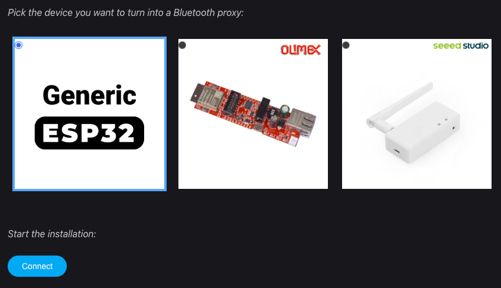
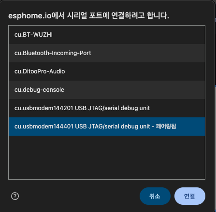
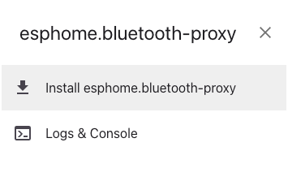
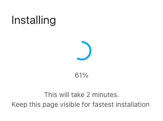
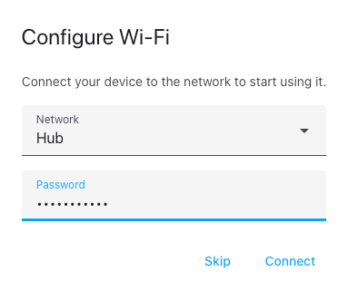
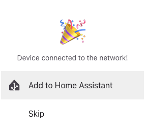
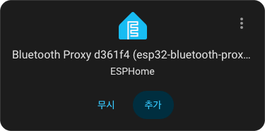

# Home Assistant Bluetooth proxy introduction and installation

**English** | [한국어](bluetooth.ko.md)

A Bluetooth proxy places a Bluetooth receiver near your device and connects it to Home Assistant over your home network. You can keep using a working local Bluetooth adapter; a proxy is useful when the Home Assistant host is too far away. Installing a custom integration alone does not configure a proxy.

This user guide also applies to integrations that do not use blesession. You do not need to install the Python library to use the guide or configure a proxy. Follow your device integration’s instructions for its own setup, authentication and support.

## What is a Bluetooth proxy?

BLE (Bluetooth Low Energy) is a low-power wireless technology used by devices such as temperature sensors, scales and locks. Walls and other obstacles can prevent their signals from reaching the Bluetooth adapter on your Home Assistant host.

A proxy receives BLE signals near the device and forwards them over your existing Wi-Fi or Ethernet network to Home Assistant. For supported devices, it also carries Home Assistant’s read/write requests.

```text
BLE device ← Bluetooth → proxy ← Wi-Fi / Ethernet → Home Assistant
```

For example, place a proxy near an entrance sensor that is too far from the server. With a supported integration, Home Assistant can receive readings and use them in automations without a nearby phone. A proxy does not add support for every Bluetooth product. This guide covers BLE, not Bluetooth Classic audio streaming; check the [Home Assistant Bluetooth guide](https://www.home-assistant.io/integrations/bluetooth/) and your device’s integration for compatibility.

You can add proxies in rooms with poor reception. Each uses your existing home network; they do not form a Bluetooth mesh between proxies. Several proxies can receive the same sensor’s advertisements, and Home Assistant brings the information together. Reception and a working connection are different, so verify an actual device operation after adding a proxy.

For a first installation, follow **choose hardware → install firmware → register in Home Assistant → check the device**. For an existing installation, see [updates](#updates) and [configuration changes](#configuration-changes).

## 1. Choose a proxy

Our default recommendation is **Seeed Studio XIAO W5500 Ethernet Adapter V1.2** for wired Ethernet, PoE and an external antenna. For a **USB-A dongle form factor**, choose **M5Stack AtomS3U**. AtomS3U has a USB-A connector and connects to your network over Wi-Fi.

| Device | Before buying | Purchase |
|---|---|---|
| **XIAO W5500 Ethernet Adapter V1.2** | Verify V1.2, the included XIAO module/antenna and PoE power options in the selected bundle. | [AliExpress](https://ko.aliexpress.com/item/1005009310322353.html) |
| **M5Stack AtomS3U** | USB-A dongle; needs USB power and Wi-Fi. Generic ESP32 web installation or a custom build. | [AliExpress](https://ko.aliexpress.com/item/1005005643544014.html) |

For the XIAO W5500, ESPHome’s [official installer](https://esphome.io/projects/?type=bluetooth) supports **V1.2 only**; older revisions have wiring/RF limitations. Check the [Seeed board guide](https://wiki.seeedstudio.com/esphome_xiao_w5500_ethernet_adapter/) and [AtomS3U specifications](https://docs.m5stack.com/en/core/AtomS3U) against the product you order. Marketplace links do not guarantee the selected revision or accessories. Recommendations are not hardware validation of every integration/device combination.

## 2. Install proxy firmware

Flashing replaces the firmware on the proxy. Save any existing configuration first. Choose the instructions for your exact device.

### Before installing

- Prepare the board, stable power, a computer and Chrome or Edge. Boards connected by cable need a USB data cable, not a charge-only cable. AtomS3U plugs directly into USB-A.
- Have a 2.4 GHz SSID/password ready for Wi-Fi boards, or a LAN connection for Ethernet boards. USB supplies power and the installation connection; normal proxy traffic reaches Home Assistant over Wi-Fi/LAN.
- Check the board, chip and revision. Use the dedicated entry for XIAO W5500 V1.2. For AtomS3U, select **Generic ESP32** in the [ESPHome web installer](https://esphome.io/projects/?type=bluetooth).

### XIAO W5500 V1.2: official installer

1. Connect the board to your computer using a USB data cable.
2. Open the [ESPHome Bluetooth installer](https://esphome.io/projects/?type=bluetooth) in Chrome or Edge, select **Seeed Studio XIAO W5500 Ethernet Adapter V1.2**, and connect to its serial port. Follow the installation prompts.
3. Connect Ethernet to your home network and use the power method supported by your board/bundle. The installed Ethernet firmware disables Wi-Fi; it needs a wired network connection.
4. Continue with Home Assistant registration below. For download-mode or board-specific instructions, use the [Seeed guide](https://wiki.seeedstudio.com/esphome_xiao_w5500_ethernet_adapter/).

Keep power and USB connected during installation. This Ethernet model does not need the installer’s Wi-Fi setup step. If an add-to-Home-Assistant button appears, use it or skip it and register manually below.

### AtomS3U and plain ESP32: web installer

For AtomS3U, select **Generic ESP32**, then **CONNECT → select serial port → INSTALL**. Windows may show a port such as `COM3`. After flashing, follow the prompts to enter the 2.4 GHz Wi-Fi credentials and register in Home Assistant. Plain ESP32 boards follow the same flow. Use a dedicated board entry where available.

### Follow the web installer screens

These examples come from the supplied installation article. Images were extracted from the PDF and the background around dialogs was cleaned up. Current device lists and button labels may differ.

**① Choose the exact board and select CONNECT.** Select Generic ESP32 as shown. For XIAO W5500 V1.2, choose its dedicated entry on the right.

<p align="center">
  
</p>

**② Select the connected USB board’s serial port.** This example is from macOS; Windows may show a `COM` port. Choose the USB board, rather than an unrelated Bluetooth serial port.

<p align="center">
  
</p>

**③ Select Install and wait for completion.** Back up the existing configuration before replacing firmware. Keep power and USB connected throughout.

| Start installation | Installation in progress |
|:---:|:---:|
|  |  |

**④ Configure the network after installation on Wi-Fi models.** Enter your own 2.4 GHz SSID and password; the pictured network is an example. For XIAO W5500 Ethernet firmware, check the LAN connection instead.

<p align="center">
  
</p>

Once connected, continue to **Add the proxy to Home Assistant** below.

<details>
<summary>Optional: build and manage AtomS3U configuration yourself</summary>

Use this alternative to the web installer when you want to manage YAML directly. The example targets AtomS3U’s ESP32-S3 and 8 MB flash.

1. Install/open [ESPHome Device Builder](https://esphome.io/install/getting-started/) and create a new ESP32-S3 device named `atoms3u-proxy`. Retain the Wi-Fi credentials and API encryption key generated during setup.
2. Edit its configuration. The minimal example below uses the AtomS3U’s ESP32-S3 and 8 MB flash; it does not enable its microphone, LED or infrared functions. Put your Wi-Fi credentials and generated API key in the Device Builder’s `secrets.yaml` under the three names shown. Use your generated key, not the placeholder. If you need a new key, run `openssl rand -base64 32` in a terminal and use its output for `atoms3u_api_key`. Keep this key private.

```yaml
esphome:
  name: atoms3u-proxy
  friendly_name: AtomS3U Bluetooth Proxy

esp32:
  variant: esp32s3
  flash_size: 8MB
  framework:
    type: esp-idf

logger:

api:
  encryption:
    key: !secret atoms3u_api_key

ota:
  - platform: esphome

wifi:
  ssid: !secret wifi_ssid
  password: !secret wifi_password

esp32_ble_tracker:

bluetooth_proxy:
  active: true
```

`secrets.yaml` entries:

```yaml
wifi_ssid: "YOUR_WIFI_NAME"
wifi_password: "YOUR_WIFI_PASSWORD"
atoms3u_api_key: "YOUR_GENERATED_BASE64_API_KEY"
```

3. Select **Validate**, then **Install**. For the first installation, connect AtomS3U to the computer’s USB-A port and choose the USB/“plug into this computer” installation route. If needed, download the firmware and upload it with [ESPHome Web](https://web.esphome.io/). Allow the browser to access the serial port. If the port is unavailable, follow [M5Stack’s AtomS3U download-mode instructions](https://docs.m5stack.com/en/arduino/m5atoms3u/program): hold the reset button for about two seconds until the green LED lights, then release it.
4. After flashing, power-cycle the device and check its Device Builder logs for a Wi-Fi connection and running API/Bluetooth proxy. Keep the API encryption key for the next step.

If adapting an old configuration, remove any `wifi.on_connect` action that calls `ble.disable`; it turns Bluetooth off after Wi-Fi connects. BLE provisioning (`esp32_improv`) is unnecessary when credentials are supplied in YAML; omit it from this dedicated proxy configuration. See [ESPHome BLE actions](https://esphome.io/components/esp32_ble/) and [BLE provisioning](https://esphome.io/components/esp32_improv/). The [M5Stack AtomS3U configuration](https://github.com/m5stack/esphome-yaml/blob/main/examples/kit/atoms3u.yaml) confirms the chip/flash/framework settings. The [ESP32 platform reference](https://esphome.io/components/esp32/) explains the chip/framework settings. This example is a configuration starting point, not a supplied or hardware-tested firmware image; validate it with your installed ESPHome version before flashing.

</details>

## 3. Add the proxy to Home Assistant

1. Keep the proxy and Home Assistant on a network where they can reach one another.
2. Open **Settings → Devices & services**. Configure the discovered ESPHome device. If it is not discovered, choose **Add integration → ESPHome** and enter the proxy’s IP address or hostname.
3. Enter the API encryption key when requested. This is the `api.encryption.key`, not the Wi-Fi password. The default native API port is **6053**.
4. Confirm the ESPHome device is connected. Then open the [Bluetooth integration](https://www.home-assistant.io/integrations/bluetooth/) and check that Bluetooth is configured. Add it through **Add integration → Bluetooth** if needed. A proxy does not require a USB Bluetooth adapter on the Home Assistant host.

The [Home Assistant ESPHome guide](https://www.home-assistant.io/integrations/esphome/) covers registration and connection options. Adding ESPHome registers the proxy; add your scale, printer or other device using its own integration afterward.

| Web installer’s Home Assistant prompt | Discovered ESPHome proxy in Home Assistant |
|:---:|:---:|
|  |  |

Add it directly on the left, or choose Skip and add the discovered entry under **Settings → Devices & services** in Home Assistant, as on the right. Device names and identifiers shown are examples; the source Home Assistant screen is in Korean.

## 4. Check the device connection

Place the proxy near the BLE device, with stable power and network access. Wake the BLE device using its model’s instructions, then add/use its integration in Home Assistant. Close another phone app or gateway connection if the device allows only one connection.

Confirm that the expected entity updates or device command completes. Merely seeing a Bluetooth advertisement does not prove a read/write connection works. Integrations that connect to devices need `bluetooth_proxy.active: true` (GATT support). Tracker **active scanning** requests extra discovery data and is a separate setting; passive scanning does not itself prevent GATT connections. Keep scan timing and connection limits at their defaults initially. See [ESPHome proxy settings](https://esphome.io/components/bluetooth_proxy/) and [BLE scanning](https://esphome.io/components/esp32_ble_tracker/).

<a id="updates"></a>

## 5. Update firmware

Home Assistant, ESPHome Device Builder and the firmware installed on the board are separate updates. Updating Device Builder still requires building and installing firmware to change the board.

1. Privately back up the working YAML, `secrets.yaml`, API key and existing OTA credentials. Record the board/revision and installed ESPHome version.
2. For a web-installed proxy, first use Device Builder’s **Take control / Adopt** feature on the discovered device; wording varies by version. Registration in the Home Assistant ESPHome integration is separate from managing YAML in Device Builder. If no entry appears, check the board’s official project configuration and import support. Do not replace XIAO Ethernet configuration with the AtomS3U Wi-Fi example.
3. Review the target ESPHome release notes and **Validate** the configuration. Resolve errors, then choose **Install → Wirelessly** or the equivalent network route. OTA installs over Wi-Fi/Ethernet without USB; it requires OTA support in the running firmware and network access from Device Builder to the board.
4. Keep power connected. After reboot, check network/API logs, Home Assistant’s ESPHome connection and a real BLE operation. Update multiple proxies one at a time.

For upload failures, check the address, network and existing OTA credentials first. The Home Assistant API key and an OTA password are not necessarily the same. Current ESPHome also supports OTA encryption using the API key; existing firmware may need a staged migration. Follow the [official OTA instructions](https://esphome.io/components/ota/esphome/). The minimal YAML above does not require OTA encryption.

<a id="configuration-changes"></a>

## 6. Change settings and recover

Open the board’s YAML in Device Builder, change the needed setting, then **Validate → Install → verify operation**. Saving an edit alone does not change the board. Keep the working configuration and change one thing at a time.

| Setting | What to change and check |
|---|---|
| Wi-Fi SSID/password | Edit the secrets referenced by `wifi`. Install while the old network still works, then check the new IP after reboot. If the old network is already unavailable, recover over USB. |
| Display name | Edit `friendly_name` and install. Changing `esphome.name` also affects the hostname; treat that as a separate change. |
| IP/network | Consider a router DHCP reservation first. After an address change, verify access and Home Assistant connectivity. Preserve board-specific Ethernet pin settings. |
| API key/OTA authentication | Retain the current values and follow the official procedure for that authentication method. An API key change may require Home Assistant reconfiguration. Changing or losing an encrypted OTA key may require USB recovery. |
| BLE connection support | Keep `bluetooth_proxy.active: true` for integrations that connect to devices. Adjust scan timing or slots only when diagnosing a demonstrated need. |

If the board repeatedly reboots after an update, inspect logs. If network/OTA still works, rebuild and install the working configuration. ESPHome [Safe Mode](https://esphome.io/components/safe_mode/) can help with recovery uploads but cannot recover every failure. If networking fails or credentials are lost, connect USB, enter the board’s download mode and reinstall firmware for the **exact board**. Do not erase everything as the first step; settings may be lost. Recheck networking and Home Assistant afterward.

<a id="troubleshooting"></a>

## Troubleshooting

Use [common Bluetooth troubleshooting](troubleshooting.md) for stage diagnostics, route interpretation and recovery order, alongside the quick checks below and your device’s guide.

| Symptom | What to try |
|---|---|
| Proxy offline in Home Assistant | Check power and network first. For XIAO Ethernet firmware, connect Ethernet. Recheck its IP address/API key and ESPHome logs. |
| BLE device not discovered (`unreachable`) | Check battery/power, wake the device and move it close to the proxy. Follow the model’s pairing/discovery instructions. |
| Device found, connection fails (`connect`) | Check GATT support, close other connected apps/gateways, and follow the model’s authentication requirements. Discovery alone does not confirm a connection. |
| No connection slot (`connect.no_slot`) | Stop overlapping operations or unused long-lived connections. If needed, spread devices across another proxy. |
| Authentication/session fails | Check the exact model/firmware and required keys or pairing. Repeated retries do not correct a wrong key or unsupported model. |
| Transfer disconnects (`link_lost`) | Check device battery, proxy power/network and distance at the failure time. Restore the connection before retrying. |
| A write hangs (`write_timeout`) | Check proxy responsiveness and connection load. Restore the affected proxy/device, then follow the integration’s retry instructions. |
| No completion confirmation | Check whether the device already performed the operation before sending it again, especially for commands with physical effects. |

Error names and available diagnostics vary by integration. Use its own troubleshooting guide for model-specific steps, retry controls and logs. A proxy has finite connection capacity; increasing retries or scan intensity is not a general fix. Keep it close to the BLE device and away from network equipment or metal enclosures that interfere with reception.

### Reporting a problem

Include Home Assistant, integration and ESPHome versions; proxy/device model and revision; network method; failure time; and steps to reproduce. Include whether discovery works and whether the actual operation succeeds. If the integration offers diagnostics or debug logging, follow its instructions, collect the failing interval, then disable debug logging. A strong advertisement signal is not proof of which proxy handled the connection.

Before posting files publicly, remove Bluetooth/MAC addresses, authentication keys, tokens, internal addresses and personal measurements or names. Compare a successful attempt with the failed one when possible.

Official instructions checked **2026-11-13**. This documentation update did not include physical installation or OTA testing.
